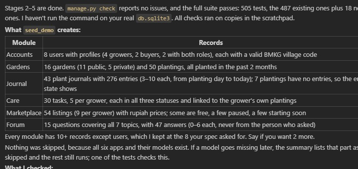

# urFunFarming

**Urban Farming Community and Local Harvest Marketplace**

Platform-Based Programming (PBP) Midterm Group Project, theme: Sustainable Living
Faculty of Computer Science, Universitas Indonesia, Odd Semester 2026/2027


## Project Links

| Resource | Link |
| --- | --- |
| Repository | https://github.com/paramitasan/urFunFarming/ |
| Deployed app (PWS) | https://paramita-santoso-urfunfarming.pws.cs.ui.ac.id/ |
| Figma design | https://www.figma.com/design/rDovEM0bwhNE0xkgKZhwV4/Farmerzz?node-id=0-1&t=uf8tBdtybxcNt5PB-1 |
| External API | [BMKG public weather forecast API](https://data.bmkg.go.id/prakiraan-cuaca/) |

## Table of Contents

1. [About the App](#about-the-app)
2. [Group Members and Modules](#group-members-and-modules)
3. [User Roles](#user-roles)
4. [Features per Module](#features-per-module)
5. [External API](#external-api)
6. [Design System](#design-system)
7. [Tech Stack](#tech-stack)
8. [Run It Locally](#run-it-locally)
9. [Demo Data and Accounts](#demo-data-and-accounts)
10. [Testing and Coverage](#testing-and-coverage)
11. [Security and Quality Notes](#security-and-quality-notes)
12. [Deployment](#deployment)
13. [Git Workflow](#git-workflow)
14. [Screenshots](#screenshots)
15. [AI Disclosure](#ai-disclosure)

## About the App

urFunFarming connects small urban growers with each other and with people nearby who want locally grown food. A resident who grows vegetables or herbs on a balcony, rooftop, small garden or hydroponic setup can:

- record their gardens and the plants in them,
- keep a dated journal of how each plant is growing,
- ask and answer growing questions in a community forum,
- post surplus harvest in a marketplace so buyers nearby can arrange pickup,
- check the weather before planning a pickup.

**Problem.** Progress notes, advice and produce offers are usually spread over separate chats and apps. urFunFarming puts them in one place, around the same gardens and growers.

**Benefit.** It makes local produce easier to find, gives growers a simple way to share or sell what they don't need (a price of zero means free), and supports people who are starting out in urban farming. These are intended benefits. We don't claim the app has already reduced waste.

The marketplace is post based. Growers post a harvest, and signed-in buyers see the grower's contact details to arrange payment and collection themselves. There is no in-app payment.

## Group Members and Modules

| Full name | NPM | Assigned module |
| --- | --- | --- |
| Angin Putih Ranulaksmi Tsurayya Hapsoro | 2506557936 | 3 |
| Azkal Azkiya Arifi Putra | 2506636991 | 2 |
| Marcel Mikula | 2606816592 | 4 |
| Muhamad Idris Kamal | 2506637073 | 1 |
| Paramita Santoso | 2506554171 | 6 |
| Tahir Ahmad | 2606816466 | 5 |

Module names: 1. Landing Page, Authentication and User Profiles; 2. Gardens and Plantings; 3. Plant Progress Journal; 4. Harvest Marketplace; 5. Care Planning and Weather; 6. Community Questions and Answers (Forum).

Each member owns one module with its own models, forms, views, URLs, templates, permissions, filters, interactivity and tests. Shared parts (base template, navbar, footer, settings, URLs, CI and deployment) were integrated together through pull requests.

## User Roles

| Role | What they can do |
| --- | --- |
| Visitor (not logged in) | See the landing page, browse marketplace listings, explore public gardens and read forum question titles. Contact details, full forum discussions and private records are hidden. |
| Grower | Everything a buyer can do, plus manage their own gardens and plantings, write plant journal entries, set each plant journal public or private, and post harvest listings. |
| Buyer | See growers' contact details on listings, read public gardens and public plant journals, and ask, answer and vote in the forum. |
| Administrator | Manage users and moderate all records through the Django admin. |

One account can be both a grower and a buyer (`accounts.Profile` has `is_grower` and `is_buyer`). Being logged in never lets a user edit someone else's records: every edit and delete view checks the owner, and private records are filtered out in the query itself, not only hidden in the template.

## Features per Module

### Module 1: Landing Page, Authentication and User Profiles (Idris)

- Landing page with real marketplace listings and a category filter (`/`, `/listings/`), plus a signed-in home page (`/home/`).
- Register (choose grower, buyer or both), login with "remember me", and logout (`/register/`, `/login/`, `/logout/`). Register and login also work through AJAX endpoints.
- Profile page to edit display name, bio, area, city, phone and contact email (`/profile/`).
- JSON endpoints: `/auth/me/json/` and `/profile/json/<username>/`.

### Module 2: Gardens and Plantings (Azkal)

- Full CRUD for gardens (name, location, growing method, public summary, private notes, public or private) and for plantings inside a garden (crop, optional name, planting date, growing method).
- "Explore gardens" for everyone, with search, location and growing method filters (`/gardens/explore/`), and "My gardens" for the owner (`/gardens/mine/`).
- Private notes and private gardens are only shown to the owner.
- Each planting links to its plant journal (Module 3).

### Module 3: Plant Progress Journal (Ranu)

- Growers write dated entries for their own plantings: date, time, height in cm, growth stage, plant health, observation and up to 5 photos (uploaded JPG/PNG/WEBP up to 5 MB, or image links).
- Journal list with search, plant, stage and health filters, sorting and pagination. Filters update the table with AJAX (`fetch`) and a debounced search box, and still work as a normal GET form (`/journal/`).
- Plant timeline page with height change since the previous entry, a growth stage tracker and newest or oldest first order (`/journal/plant/<id>/`).
- Create, edit and delete entries, and delete all entries of a plant, with a confirm dialog and toasts.
- Visibility is set per plant journal with a lock button (AJAX). Buyers reach a public plant from the garden page and see a read-only timeline; a private plant shows "This journal is private" and its entries are never sent to the page.
- Photos and links are checked on the server, not only in JavaScript, and thumbnails are built without `innerHTML` to avoid XSS.

### Module 4: Harvest Marketplace (Marcel)

- Full CRUD for harvest listings: title, description, crop category, quantity and unit, price (zero shows as Free), availability dates, pickup area and city, optional photo link.
- Live search, combined filters, sorting and pagination with `fetch`; the normal form still works without JavaScript (`/marketplace/`, `/marketplace/mine/`).
- Grower contact details are only shown to signed-in users, in both HTML and JSON.
- Pickup weather filter using BMKG forecasts (see [External API](#external-api)).
- JSON API: `/marketplace/api/listings/` and `/marketplace/api/listings/<id>/`.
- More detail in [docs/marketplace.md](docs/marketplace.md).

### Module 5: Care Planning and Weather (Tahir)

- Full CRUD for care tasks linked to the grower's own plantings: activity (for example watering), title, target date and optional time, notes and status (`/care/`).
- Change a task's status from the list, and filter the task list.
- Each grower sets their own weather limits (maximum rain, temperature and wind) in care settings, and the app suggests good times for a task from the BMKG forecast.
- Care tasks are private to their owner.

### Module 6: Community Questions and Answers (Paramita)

- Full CRUD for questions (title, description, topic, optional image) and replies, with an "edited" label (`/forum/`).
- Search, topic filter, answered or unanswered filter, sort and pagination.
- Upvotes for questions and replies, and the author can mark a question as answered.
- Visitors see question titles only; the full discussion needs login. Only the author can edit or delete their own post or reply.

## External API

We use the **[BMKG public weather forecast API](https://data.bmkg.go.id/prakiraan-cuaca/)** (Badan Meteorologi, Klimatologi, dan Geofisika). It is free, needs no API key, and gives forecasts for Indonesian villages by their area code (kode wilayah tingkat IV), which fits our Jabodetabek users.

How it is used:

- **Shared weather service** (`weather/services.py`): every page that shows weather goes through this one file. The server calls BMKG, never the browser, and turns the response into simple hourly slots (temperature, rain, wind, humidity).
- **Care planning (Module 5):** the forecast for the grower's area is compared with their own limits to suggest good times for a care task.
- **Marketplace (Module 4):** a buyer can filter pickup hours on a listing by date, time window, maximum rain and maximum temperature. Only hours inside the listing's availability are shown. The forecast is taken for the collection city's centre, never the grower's address.
- **Profile locations (Module 1):** the city, district and village dropdowns come from a local file (`accounts/data/jabodetabek.json`) with the same area codes BMKG uses.
- **Failure handling:** results are cached for an hour (BMKG updates twice a day and limits requests per IP), requests time out after 5 seconds, and after a failure the app waits a few minutes before asking again. Pages then show "Weather is unavailable right now" instead of breaking.
- Tests mock BMKG, so CI never calls the real service.

## Design System

- **Figma:** all screens are designed in the group file [Farmerzz](https://www.figma.com/design/rDovEM0bwhNE0xkgKZhwV4/Farmerzz?node-id=0-1&t=uf8tBdtybxcNt5PB-1), with one page per module (for example the PlantProgressJournal page has the list, timeline, forms, buyer views, delete overlays and all toasts).
- **Shared layout:** every page extends `templates/base.html` with the same navbar, footer and grower sub navigation (`templates/partials/`).
- **Shared tokens:** colors, radius, shadows and the Poppins font are CSS variables in the `:root` of `static/css/style.css`, and each module's CSS (`static/<module>/`) reuses them, so the modules look like one app.
- **Icons:** exported from the Figma file as SVG (Feather style), not AI generated.
- **Responsive:** layouts use Flexbox, Grid and media queries; the marketplace also uses a locally vendored Bootstrap 5.3.3 grid. Pages work on phone width (see the mobile screenshot below).
- **Interactivity:** `fetch` with the CSRF token (Tutorial 5 style) for filters, toggles and deletes, toasts for feedback, and HTMX in `templates/partials/chips.html`.

## Tech Stack

- Python 3.12, Django 5.2 (MVT, function views, ModelForms)
- SQLite locally, PostgreSQL on PWS
- HTML templates, plain CSS, vanilla JavaScript, HTMX, Bootstrap grid (marketplace)
- WhiteNoise for static files, Pillow for image uploads, Requests for the BMKG API
- `coverage` and Django `TestCase`, GitHub Actions for CI

## Run It Locally

```bash
git clone https://github.com/paramitasan/urFunFarming.git
cd urFunFarming
python -m venv env
# Windows: env\Scripts\activate    macOS/Linux: source env/bin/activate
pip install -r requirements-dev.txt
python manage.py migrate
python manage.py seed_demo
python manage.py runserver
```

Open http://127.0.0.1:8000/. Without the `PRODUCTION` environment variable the app uses SQLite, so no `.env` file is needed for local work. To make an admin account, run `python manage.py createsuperuser`, then log in at http://127.0.0.1:8000/admin/ to manage users and moderate any record.

## Demo Data and Accounts

`python manage.py seed_demo` fills every module with demo content set in Jakarta and Depok. Photos are left empty, so the "no photo" tiles show. The data is the same on every run, and dates are counted back from the day you run it.

| Module | Records |
| --- | --- |
| Accounts | 8 users with profiles (4 growers, 2 buyers, 2 with both roles), each with a valid BMKG village code |
| Gardens | 16 gardens (11 public, 5 private) and 50 plantings, all planted in the past 2 months |
| Journal | 43 plant journals with 276 entries (3 to 10 each, from planting day to today); 7 plantings have no entries, so the empty state shows |
| Care | 30 tasks, 5 per grower, in all three statuses and linked to the grower's own plantings |
| Marketplace | 54 listings (9 per grower) with rupiah prices; some are free, a few paused, a few starting soon |
| Forum | 15 questions covering all 7 topics, with 47 answers (0 to 6 each, never from the person who asked) |



**Locally**, after `python manage.py migrate`:

```
python manage.py seed_demo
```

**On PWS**, set the `DEMO_PASSWORD` environment variable first, then run the same command wherever you run `migrate` for the deployment. Add `--force` if `DEBUG` is off there.

| Flag | What it does |
| --- | --- |
| *(none)* | Creates whatever is missing. Running it again adds no duplicates. |
| `--reset` | Deletes every account whose username starts with `demo_`, and everything those accounts own, then seeds again. Other accounts are never touched. This also removes the `demo_` accounts made by `seed_journal` and `seed_marketplace`. |
| `--force` | Lets the command run while `DEBUG` is off. Without it, the command refuses. |

All demo users share one password: the `DEMO_PASSWORD` setting, which is read from the environment and defaults to `tanam-sayur-demo` for local use.

| Username | Role | Area |
| --- | --- | --- |
| `demo_ayu` | Grower | Tebet, Jakarta Selatan |
| `demo_bima` | Grower | Beji, Depok |
| `demo_rina` | Grower | Pulogadung, Jakarta Timur |
| `demo_dimas` | Grower | Pancoran Mas, Depok |
| `demo_nadia` | Grower and buyer | Beji, Depok |
| `demo_yoga` | Grower and buyer | Jagakarsa, Jakarta Selatan |
| `demo_sekar` | Buyer | Tebet, Jakarta Selatan |
| `demo_fajar` | Buyer | Beji, Depok |

## Testing and Coverage

```bash
coverage run --source=accounts,main,marketplace,forum,gardens,journal manage.py test
coverage report
```

Result on 30 Oct 2026: **505 tests, all passing**. Coverage was 98% across the six apps at the last full measurement (430 tests, before `seed_demo` and its tests). Tests cover valid and invalid forms, full CRUD, owner checks, login-only data, private records, filters and pagination, JSON endpoints, CSRF, input escaping, weather API failures (mocked) and the seed commands.

GitHub Actions (`.github/workflows/django-tests.yml`) runs on every pull request and on pushes to `main` and feature branches. It runs `manage.py check`, checks that no migrations are missing, runs `collectstatic`, then runs the tests with a minimum coverage of 80% (`.coveragerc`).

## Security and Quality Notes

- **Owner checks on the server:** every edit and delete view checks that the logged-in user owns the record. Hiding the buttons is only for looks; a direct POST from someone else is refused.
- **Private data never reaches the page:** private gardens, private notes and private plant journals are filtered out in the database query. Grower contact details are left out of both the HTML and the JSON for visitors.
- **CSRF:** every form uses ``, and every `fetch` call sends the `X-CSRFToken` header.
- **XSS:** templates use Django's auto-escaping. JavaScript shows user text with `textContent`, and any HTML loaded with `fetch` is rendered and escaped by Django on the server first.
- **Safe redirects:** login and forum "next" links are checked with `url_has_allowed_host_and_scheme`, so they can't send users to another site.
- **Upload checks:** journal photos are checked on the server for type (JPG, PNG, WEBP), size (5 MB) and count (5 per entry), not only in JavaScript.
- **Lighter queries:** list pages use `select_related`, `prefetch_related` and `annotate`, so a page doesn't run one query per card.
- **Secrets stay out of git:** database details come from environment variables (`.env` locally, PWS environment settings in production), and `.env*` is in `.gitignore`.

## Deployment

The app is deployed on PWS: https://paramita-santoso-urfunfarming.pws.cs.ui.ac.id/

- `uff/settings.py` switches database by the `PRODUCTION` environment variable: SQLite in development, PostgreSQL on PWS (`DB_NAME`, `DB_HOST`, `DB_PORT`, `DB_USER`, `DB_PASSWORD`, `SCHEMA`).
- Database credentials are set as PWS environment variables and are never committed.
- Static files are served by WhiteNoise after `collectstatic`.
- Only `main` is deployed. A feature reaches `main` through a reviewed pull request with passing CI.

## Git Workflow

- `main` is the integration branch. Each member works on their own feature branch (for example `feat/harvest-marketplace`, `feat/gardens-and-plantings`, `fix/journal-review`) and opens a pull request into `main`.
- Members merge the latest `main` into their branch before opening a pull request and resolve conflicts in shared files (`settings.py`, `uff/urls.py`, `requirements.txt`, shared partials) by keeping both sides.
- Commits are small and use prefixes: `feat:`, `fix:`, `style:`, `refactor:`, `test:`, `docs:`.
- Pull requests must pass CI before merging. The full history is in the repository's [pull requests](https://github.com/paramitasan/urFunFarming/pulls?q=is%3Apr).

More docs: [docs/team-guide.md](docs/team-guide.md) (how we work together), [docs/credits.md](docs/credits.md) (data, images, fonts and libraries we use), [docs/marketplace.md](docs/marketplace.md) (Module 4 details).

## Screenshots

Taken from a local run with the demo data.

| Marketplace | Explore gardens |
| --- | --- |
|  |  |

| Plant journal (grower) | Marketplace on a phone |
| --- | --- |
|  |  |

## AI Disclosure

We used AI tools as helpers during this project. Each member is responsible for their own module and can explain every part of it. No AI-generated images or logos are used anywhere in the app or the Figma file.

### Tools and what we used them for

| Tool | Used for |
| --- | --- |
| ChatGPT | Drafting the first project description and module plan (Checkpoint 1), and help with the marketplace implementation, tests and its documentation ([docs/marketplace.md](docs/marketplace.md)) |
| Claude Code (Anthropic, in VS Code) | Turning Figma frames into Django templates and CSS, planning views and models, explaining errors, writing tests, and resolving merge conflicts in shared files |
| Claude (claude.ai) | Planning pieces of work, checking AI-written plans before accepting them, explaining git messages, and drafting group messages. It did not write code into the project |
| Figma MCP | Letting the assistants read (never edit) our Figma frames |

### How we used it

- **We stayed in control of the code.** The AI suggested changes and explained them; we read, typed or applied them ourselves and ran every commit, push, merge and migration ourselves.
- **Plan first, then build.** For bigger pieces we asked for a plan first, checked it against the repo and the Figma design, and corrected it before any code was written.
- **Small steps.** We worked one screen or one feature at a time, tested it in the browser, then committed it with a `feat:` / `fix:` / `test:` style message.
- **Follow the course style.** We asked for the PBP tutorial patterns (function views, ModelForms, `fetch` with the CSRF token, Django `TestCase`) so the code stays familiar and we can defend it.
- **We made the decisions.** Scope, module split, design and behaviour choices (for example who can see what, photo limits, which filters exist) were decided by us, not by the AI.

### Limitations we ran into and what we fixed by hand

- **Out-of-date view of the repo.** A first plan said the marketplace app didn't exist because a branch hadn't been fetched yet, and it missed the existing grower role (`Profile.is_grower`). We checked GitHub and corrected the plan.
- **Design details.** Generated templates were sometimes off from Figma (text too big, an arrow pointing the wrong way, the fixed navbar covering the top of a page). We compared each page with the Figma frame and fixed them.
- **Small logic bugs.** A link with `#timeline` made the page jump; `floatformat` rounded 12.75 cm to one decimal; removing all photos on Edit didn't bring back the upload box. We found these while testing and fixed them.
- **Missing tests.** Tests for a seed command were forgotten until the coverage report showed the gap.
- **Integration.** The AI didn't plan for teammates' apps being merged later; when the gardens app landed, a temporary model had to be removed and migrations reset by hand.
- **Figma gives React and Tailwind code**, which we don't use, so every frame had to be rewritten as Django templates and plain CSS.

### Per module

#### Module 1: Landing Page, Authentication and User Profiles (Idris)

**Tools and purpose**

- **Claude Code** (Anthropic) inside VS Code as a coding assistant. It edited the project files in small stages from my instructions.
- **Claude on claude.ai** as a design and planning helper in a separate chat. It helped me when I was confused about git, reviewed Claude Code's results and explained git problems.
- **Figma MCP**, so Claude on claude.ai could read the design frames and tell me what still didn't match the Figma design.

**Prompt strategy**

- I wrote the cookie handling in the auth views myself (setting and deleting the `last_login` cookie and the "Remember me" session behaviour). I used AI mainly for the HTML templates, CSS and JavaScript (AJAX forms, password toggle, navbar menu, GSAP animations).
- Every prompt required the PBP tutorial patterns: function views (`register`, `login_user`, `logout_user`), `UserCreationForm` and `AuthenticationForm`, `@login_required`, messages and ``, so I could explain each part.
- Before opening a pull request I ran a review-only pass: Claude Code listed bugs and duplicated code, and things were only changed after I edited them myself.
- I made the design and behaviour decisions myself, for example the double navbar with a grower sub-nav, a signed-in Home page that doesn't depend on other modules' data, no profile photo upload (no file storage on PWS), no scroll-pinned animations, and animations that always run but stay small and fast.

**Limitations and manual fixes**

- Login seemed to be forgotten between pages. The causes were signed-in users seeing an empty login form, separate cookies for `localhost` and `127.0.0.1`, and a CSRF "Origin checking failed" error on PWS, fixed with `CSRF_TRUSTED_ORIGINS`.
- The animations didn't run at all when Windows "Animation effects" was off, because of a reduced-motion check. I changed them to always run, with shorter movement and faster text.
- The market preview first showed "Image placeholder" text and hard-coded listings in the template. I moved the demo listings into the view with a TODO for Module 4.
- Users created with `createsuperuser` had no `Profile`, so `user.profile` crashed. Profiles are now created automatically.
- The first signed-in Home design needed data from four other modules, so I simplified it to only use Module 1 data and links.
- Long design and code changes sometimes had layout bugs (navbar overflowing, misaligned cards, overlapping logos), which I found from screenshots and asked to be fixed.

#### Module 3: Plant Progress Journal (Angin)

**Tools and purpose**

- **Claude Code** (Anthropic) inside VS Code as a coding assistant.
- **Claude on claude.ai** as a planning helper in a separate chat. It did not write code into the project. It helped plan the module, write the instructions given to Claude Code, check Claude Code's plans, explain errors and git messages, and draft messages to the group.
- **Figma MCP**, so both assistants could read (never edit) the PlantProgressJournal frames.

**Prompt strategy**

- Claude Code was set up so it could not create or edit project files or run git commands that change anything. For every change it showed the file, the place, the old and new code and a short explanation, and **I typed every change myself**. Afterwards it read the file and pointed out my typos instead of fixing them.
- It had to follow the PBP tutorial style (function views, ModelForm, templates, `fetch` with the CSRF token, `TestCase`) and explain each piece so I could defend it.
- For big pieces it first wrote a plan in Plan mode, which I checked with the planning helper and corrected before accepting.
- I worked one Figma frame at a time ("Plant Journal (list)", "New Entry (errors)" and so on), sent screenshots when something looked wrong, and asked it to read the frame again whenever I changed the design.
- I made the design and behaviour decisions myself, for example visibility per plant journal instead of per entry, uploads and links with a limit of 5 photos, a private screen for buyers, AJAX filters with normal dropdowns, no Undo on delete toasts and only one toast at a time.
- I ran all commits, pushes, merges, `makemigrations` and `migrate` myself.

**Limitations and manual fixes**

- Its first plan said the marketplace app didn't exist, because my laptop hadn't fetched that branch. The planning helper checked GitHub and corrected it.
- The first plan also missed the existing grower role (`Profile.is_grower`) and a buyer page for an empty journal. I had both added before building.
- The timeline order link used `#timeline`, which made the page jump. I changed it to load with `fetch`.
- That link first came out bigger than the design with the arrow pointing sideways. I caught both from screenshots.
- `floatformat` showed one decimal by default, so 12.75 cm looked wrong until we used `floatformat:"-2"`.
- The fixed navbar covered the top of the buyer pages until the padding was fixed after I saw it in the browser.
- Toast icons broke when the server was off, so they are now preloaded.
- It forgot tests for `seed_journal` until the coverage report showed the gap.
- On Edit, removing every saved photo didn't bring back the big upload box. I found this while testing, and the template now uses one layout for both New and Edit.
- While Module 2 wasn't merged I used a temporary Garden and Planting model with my teammate's OK. When the gardens app was merged, I switched to `gardens.Planting` and reset my migrations, which the AI didn't plan for at first.
- Long code blocks sometimes got cut off when pasted, so I asked for smaller steps.

**Chat history:** [Claude Code log for Module 3](https://gist.github.com/anginputih-droid/571ff3ef996a465baf72cf448b11ff50). It is an edited excerpt of the real log: private data (email, passwords, local paths), off-topic parts and another member's module were removed, and long code and tool output were shortened. Every cut is marked with [...] or [Removed: ...]. Nothing was reworded, added or reordered. The planning chat with Claude on claude.ai is not linked because it also covers other members' work, but it can be shown on request.

#### Module 4: Harvest Marketplace (Marcel)

ChatGPT assisted with the Django implementation, adapting the shared Figma design, tests and integration documentation. See [docs/marketplace.md](docs/marketplace.md) for the scope and how it was verified.

#### Module 6: Discussion Forum (Paramita)

**Tools and purpose**

- **Claude on claude.ai** (Anthropic, Claude Sonnet 5.5) in one chat, used as a code reviewer and helper for the forum module only. I uploaded the forum files (`models.py`, `forms.py`, `views.py`, `urls.py`, the templates, CSS and JS), then `base.html`, `style.css`, `settings.py` and the project `urls.py` when asked. Claude read them and wrote its findings, fixes and test code in the chat. It had no access to my repository, database or server, and it could not run my project.
- I used it for four things:
  - a review for bugs and vulnerabilities;
  - a unit test file for the forum module;
  - fixes for specific problems I reported;
  - a management command to seed demo data on PWS.

**Prompt strategy**

- I first gave the full context: the stack, the module brief and all forum files. I asked for bugs and vulnerabilities, with the code, where to add it and which other files needed changes.
- I also asked Claude which extra files I should upload, then uploaded `settings.py` and the project `urls.py`.
- I asked for the unit tests (coverage above 80%) as a separate step, after the review.
- My follow-up prompts were narrow:
  - one bug I found myself: the reply sort resets after creating or editing a reply;
  - two items from the review, rate limiting and session size, where I asked for a "complete and concise guide".
- For the seed data I gave Claude my Profile model and the 10 display names.
- I decided which suggestions to apply. <!-- Mita: say which ones you applied, changed or skipped -->

**Limitations and manual fixes**

- Claude could not run Django in its environment, so the fixes, tests and seed script were not run by it. I ran them myself. <!-- Mita: add your results: coverage %, which tests failed and what you changed -->
- The first review was written without my accounts app. Claude assumed `accounts:login`, the standard user model and the Profile fields, and the tests depend on these assumptions.
- The first review missed that `reply_create` and `reply_edit` redirect without the chosen sort. I found this while testing, and Claude then fixed both redirects to keep it.
- For rate limiting, Claude first suggested a library. After seeing my `settings.py` (no `CACHES`, so each worker would count separately), it switched to a small custom limiter using a shared database cache. It also stored the window start in the cached value, because `incr` on a database cache can extend the expiry.
- Files Claude generated in the chat were lost or replaced between messages, so some later code came as snippets that I had to merge by hand. <!-- Mita: edit if this didn't happen to you -->
- The seed script assumes Profile is in `accounts.models` and that it goes in `main/management/commands/`. It creates accounts with fake data and one shared password. <!-- Mita: confirm whether you ran it on PWS -->
- Claude also pointed out `DEBUG = True`, the committed `SECRET_KEY` and media serving in production. These were advice only. <!-- Mita: say what you changed -->

**Chat history:** https://claude.ai/share/268309b0-3ec8-47a5-b2ff-afb44702c572. This was one claude.ai chat that covers only the forum module.

#### Modules 2 and 5

The owners' own AI disclosure was not received before the deadline. Any AI use in those modules is the owner's to disclose.
